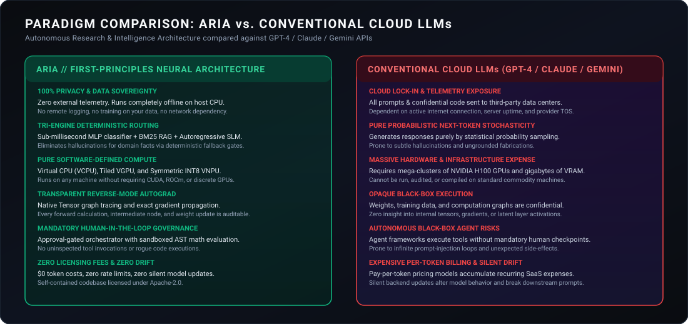

# ARIA: Autonomous Research and Intelligence Architecture

[](https://www.python.org/)
[](LICENSE)
[](tests/)
[](src/aria/)
[](#privacy-and-data-sovereignty)
[](docs/COMPUTE_BACKENDS.md)

ARIA is a software-only, local-first intelligence architecture engineered from first principles around an owned neural core. It implements reverse-mode automatic differentiation, causal transformer attention, RMSNorm, software-defined compute devices (VCPU, VGPU, VNPU), a virtual DAG compute scheduler, BM25 lexical retrieval-augmented generation (RAG), and a deterministic byte tokenizer without external cloud APIs or proprietary framework dependencies.

---

## Visual Architecture Overview

<p align="center">
  
</p>

---

## Architectural Paradigms: ARIA vs. Conventional Cloud LLMs

ARIA was intentionally designed with an architectural philosophy distinct from conventional hyperscaler language models such as OpenAI GPT-4, Anthropic Claude, and Google Gemini.

<p align="center">
  
</p>

### Detailed Technical Comparison

| Dimension | Conventional Cloud LLMs (GPT-4, Claude, Gemini) | ARIA (Autonomous Research & Intelligence Architecture) |
|---|---|---|
| **System Ownership** | Proprietary black box accessed via remote REST API. | 100% owned, inspectable source code in pure Python. |
| **Telemetry & Privacy** | Prompts, embeddings, and completions transit public networks to third-party data centers. | Zero network egress. 100% private, local-first execution on host hardware. |
| **Inference Mechanism** | Pure autoregressive probabilistic next-token generation across billions of parameters. | Tri-Engine Hybrid Routing: deterministic MLP classifier, BM25 lexical RAG, and autoregressive SLM. |
| **Hallucination Risk** | Inherent stochastic risk; cannot guarantee factuality without complex external scaffolding. | Deterministic routing for domain tags and verified local documents eliminates hallucinations for known knowledge. |
| **Compute Requirements** | Dedicated clusters of enterprise GPUs (NVIDIA H100/A100) with tens of gigabytes of VRAM. | Software-defined compute virtualization (VCPU, VGPU, VNPU) running on any standard CPU. |
| **Hardware Dependencies** | Proprietary driver stacks (CUDA, ROCm, cuDNN, Metal). | Pure Python standard library core; zero mandatory accelerator drivers. |
| **Autograd & Transparency** | Weights and gradients are hidden behind an opaque token endpoint. | Fully inspectable computational graph with native reverse-mode automatic differentiation. |
| **Quantization Architecture** | Post-training quantization requiring specialized hardware execution (bitsandbytes, AWQ, EXL2). | Native symmetric INT8 quantization simulated directly in the virtual NPU (`VirtualNPUBackend`). |
| **Tool Execution Safety** | Autonomous agent tool dispatch susceptible to prompt injection and uncontrolled loops. | Orchestration pipeline with mandatory human-in-the-loop approval and sandboxed AST mathematical evaluation. |
| **Economic Model** | Recurring per-million token billing, monthly subscription tiers, and API rate limits. | Zero operational cost. Completely free and open-source under Apache-2.0. |
| **Model Drift** | Continuous unannounced upstream updates alter model outputs and degrade established prompts. | Fully deterministic checkpoints and freeze policies ensuring immutable inference behavior over time. |

---

## How the Architecture Works

ARIA operates as a layered modular system designed for predictability, auditable computation, and zero cloud lock-in.

```text
+---------------------------------------------------------------------------------------+
|                                    CLIENT INTERFACES                                  |
|   Obsidian Web Studio (app.py)  |  Loopback REST API (server.py)  |  Terminal CLI     |
+---------------------------------------------------------------------------------------+
                                           |
                                           v
+---------------------------------------------------------------------------------------+
|                                 INGESTION & TOKENIZATION                              |
|           ByteTokenizer: Deterministic 8-bit byte mapping (0-255) + Special Tokens     |
|           Input validation, payload bounding, and non-standard constant filters       |
+---------------------------------------------------------------------------------------+
                                           |
                                           v
+---------------------------------------------------------------------------------------+
|                            TRI-ENGINE HYBRID ROUTING MATRIX                           |
|                                                                                       |
|   [ Intent Classifier ] ----------> [ BM25 Lexical RAG ] ---------> [ Transformer SLM ]|
|   TF-IDF + MLP Neural Net           Sliding window chunker          Causal Self-Attention |
|   Sub-millisecond matching          BM25 k1=1.5, b=0.75             RMSNorm + Linear head|
|   High-confidence tags (<0.35)      Local grounded context          Autoregressive gen    |
+---------------------------------------------------------------------------------------+
                                           |
                                           v
+---------------------------------------------------------------------------------------+
|                             TENSOR BRAIN & VIRTUAL COMPUTE                            |
|                                                                                       |
|   Tensor Autograd Engine            Compute Scheduler               Virtual Backends  |
|   Reverse-mode dynamic DAG          FIFO command queue              VCPU: IEEE FP32   |
|   Matrix backward propagation       Logical workgroup tiling        VGPU: Cache tiled |
|   dC = dA x B^T | dB = A^T x dC     Estimated memory reservations   VNPU: INT8 quant  |
+---------------------------------------------------------------------------------------+
                                           |
                                           v
+---------------------------------------------------------------------------------------+
|                                GOVERNANCE & ORCHESTRATION                             |
|   ToolRegistry: AST-verified arithmetic, system introspection, parameter validation   |
|   Human Approval Gate: Mandatory verification boundary before executing tool actions  |
|   State & Memory: JSONL conversation logging, mid-epoch checkpoint recovery           |
+---------------------------------------------------------------------------------------+
```

### 1. The First-Principles Autograd Tensor Engine (`aria.brain.tensor`)

At the core of ARIA is an independent tensor automatic differentiation engine built without relying on PyTorch, JAX, or TensorFlow:

- **Dynamic Reverse-Mode Autodiff**: Every tensor records its generating operation (`leaf`, `matmul`, `add`, `multiply`, `sum`, `reshape`, `relu`, `rmsnorm`, `attention`).
- **Graph Tracing**: Invoking `tensor.graph_trace()` generates an immutable, inspectable topological execution DAG validating dependencies and parameter gradient requirements.
- **Matrix Multiplication Backward Pass**: For forward projection $C = A \cdot B$, exact gradients are propagated via:
  $$\frac{\partial L}{\partial A} = \frac{\partial L}{\partial C} \cdot B^T$$
  $$\frac{\partial L}{\partial B} = A^T \cdot \frac{\partial L}{\partial C}$$
- **Gradient Isolation**: Intermediate node gradients are tracked and cleared via `zero_grad()`, while shared parameters correctly accumulate gradients across complex branched graphs.

### 2. Software-Defined Compute Devices (`aria.compute.backends`)

ARIA decouples neural mathematics from physical hardware through virtual software backends:

- **Virtual CPU (`VirtualCPUBackend`)**: The reference IEEE-754 floating-point implementation supporting full autograd training and validation.
- **Virtual GPU (`VirtualGPUBackend`)**: Tiled matrix multiplication simulating L1/L2 cache locality and block decomposition while preserving exact reverse-mode derivatives.
- **Virtual NPU (`VirtualNPUBackend`)**: Quantized integer inference engine using symmetric INT8 quantization:
  $$s = \frac{\max(|X|)}{127}, \quad X_{q} = \text{clip}\left(\left\lfloor \frac{X}{s} \right\rceil, -127, 127\right)$$
  The VNPU executes matrix accumulation in integer space and prohibits tracked gradient operations to safeguard against undefined quantized backward passes.

### 3. Virtual Compute Scheduler (`aria.compute.scheduler`)

To manage execution order, memory usage, and concurrency:

- **FIFO Command Queue**: Manages command dependencies, detects topological graph cycles, and ensures sequential or worker-pool execution.
- **Logical Workgroup Partitioning**: Slices matrix calculations into planned workgroups for deterministic scheduling.
- **Estimated Memory Reservations**: Enforces strict memory budgets prior to batch execution, rejecting workloads exceeding memory capacity.
- **Cooperative Cancellation**: Scoped execution contexts (`ScheduledExecutionContext`) track elapsed time, active command IDs, and permit non-destructive cancellation between kernel boundaries.

### 4. Tri-Engine Hybrid Inference Pipeline

Rather than passing every simple prompt to a heavy language model, ARIA uses an intelligent tri-engine hierarchy:

1. **Engine 1: Multi-Layer Perceptron Intent Classifier (`chatbot.py`)**
   - Uses TF-IDF n-gram vectorization coupled with a multi-layer neural network.
   - Evaluates intents in sub-millisecond execution times.
   - When confidence exceeds the 0.35 threshold, it produces deterministic, instantaneous responses for greetings, identity queries, navigation commands, and standard domain questions.
2. **Engine 2: Local BM25 Lexical RAG (`src/aria/rag`)**
   - When domain context is needed, incoming queries are routed to an in-memory BM25 retrieval index.
   - Documents are tokenized and split via sliding-window chunking (default chunk size: 128 tokens, overlap: 64 tokens).
   - Relevant text chunks are retrieved and assembled with explicit provenance tracking without calling hosted vector databases or remote embedding APIs.
3. **Engine 3: Autoregressive Decoder Transformer (`src/aria/brain/transformer.py`)**
   - For open-ended generation, inputs are dispatched to ARIA's causal language model.
   - Features single/multi-head causal self-attention with upper-triangular masking:
     $$\text{Attention}(Q, K, V) = \text{softmax}\left(\frac{Q K^T}{\sqrt{d_k}} + M\right) V, \quad M_{ij} = \begin{cases} 0 & i \ge j \\ -\infty & i < j \end{cases}$$
   - Uses RMSNorm pre-normalization for training stability and cross-entropy next-token prediction.

### 5. Deterministic Tokenization (`src/aria/tokenizer`)

ARIA avoids external BPE or sentencepiece libraries by utilizing a pure-Python `ByteTokenizer`:
- Maps directly to the 256 fundamental byte values (`0x00` through `0xFF`).
- Incorporates dedicated indices for `[PAD]` and `[EOS]`.
- 100% immune to Out-Of-Vocabulary (OOV) errors across any Unicode text, binary string, or programming syntax.

### 6. Agent Governance & Human-in-the-Loop Orchestration (`src/aria/agent`)

ARIA tools are strictly audited and guarded:
- **Zero Raw Code Execution**: Mathematical expressions are evaluated using a recursive Abstract Syntax Tree (AST) parser (`safe_calculate`), disallowing `eval()` or unwhitelisted operators.
- **Schema Contracts**: Every registered tool enforces explicit JSON schema parameters.
- **Mandatory Approval Barrier**: Multi-step agent plans require human confirmation before any side-effecting action is dispatched.

---

## Repository Structure

```text
ARIA/
├── app.py                      # Flask Application Factory & Obsidian Web Studio
├── chatbot.py                  # Multi-Layer Perceptron Intent Classifier & TF-IDF
├── chatbot_model.pkl           # Pre-trained neural intent model cache
├── intents.json                # Structured dataset of patterns, tags, and responses
├── pyproject.toml              # PEP 517/621 build config, Ruff, Mypy, and Pytest specs
├── requirements.txt            # Optional web & ML dependencies (Flask, NumPy, Scikit-Learn)
├── README.md                   # System technical manual and reference guide
├── LICENSE                     # Apache-2.0 Open-Source License
├── docs/                       # Technical architecture & compute specifications
│   ├── assets/                 # Architecture flow & animated SVG visuals
│   │   ├── aria-architecture-flow.svg
│   │   └── aria-vs-llms.svg
│   ├── COMPUTE_BACKENDS.md     # Mathematical specification of VCPU, VGPU, and VNPU
│   └── IMPLEMENTATION_AUDIT.md # Verification evidence, baseline matrix, and audit logs
├── scripts/                    # Compute, batching, and inference diagnostic benchmarks
│   ├── benchmark_compute.py
│   ├── benchmark_compute_batch.py
│   ├── benchmark_inference.py
│   └── benchmark_scheduled_transformer.py
├── src/
│   └── aria/                   # Core First-Principles Neural Framework (Zero external deps)
│       ├── agent/              # ToolRegistry, AST tools, and approval orchestrator
│       ├── api/                # Loopback REST API server with security hardening
│       ├── brain/              # Tensor autograd, neural layers, optimizers, transformer
│       ├── cli.py              # Unified command-line interface
│       ├── compute/            # VCPU, VGPU, VNPU virtual devices & FIFO DAG scheduler
│       ├── evaluation/         # Perplexity, parameter health, and gradient verification
│       ├── inference/          # Deterministic autoregressive generation
│       ├── memory/             # JSONL conversation store and literal search
│       ├── rag/                # BM25 lexical retriever, sliding chunker, text pipeline
│       ├── runtime/            # In-memory execution lifecycle manager
│       ├── tokenizer/          # ByteTokenizer (byte-level 0-255 mapping)
│       ├── training/           # Autograd trainer, checkpointing with mid-epoch cursor
│       ├── ui/                 # Standalone dependency-free loopback HTML interface
│       └── verification/       # Shape contracts and structural response verification
├── static/                     # Obsidian Dark Theme client styling and JavaScript
│   ├── css/chatgpt.css
│   └── js/chatgpt.js
├── templates/
│   └── index.html              # ChatGPT-inspired minimalist Web Studio UI
└── tests/                      # 310 Comprehensive Unit & Integration Tests
```

---

## Quickstart & Installation

### 1. Prerequisites

- Python 3.11, 3.12, 3.13, or 3.14.
- Standard CPython runtime (Windows, macOS, or Linux).
- Hardware: Standard x86_64 or ARM64 CPU. No discrete GPU required.

### 2. Environment Setup

Clone the repository and create an isolated virtual environment:

```bash
git clone https://github.com/chamanvashishth/ARIA.git
cd ARIA
python -m venv .venv
```

Activate the environment:

- **Linux / macOS**:
  ```bash
  source .venv/bin/activate
  ```
- **Windows (PowerShell)**:
  ```powershell
  .\.venv\Scripts\Activate.ps1
  ```
- **Windows (Command Prompt)**:
  ```cmd
  .\.venv\Scripts\activate.bat
  ```

### 3. Dependency Installation

Core ARIA (`src/aria/`) requires **zero external dependencies** and runs on the Python standard library alone. To install the optional Web Studio interface and intent classification dependencies:

```bash
pip install -r requirements.txt
```

Or install in editable mode with development tooling:

```bash
pip install -e .[web,dev]
```

---

## Running ARIA

### Option A: Obsidian Web Studio (ChatGPT-Style UI)

Launch the full web interface featuring high-contrast typography, syntax-highlighted code blocks, and real-time engine selection:

```bash
python app.py
```

Or via the ARIA CLI:

```bash
python -m aria.cli web --port 5000
```

Open your browser at:
`http://127.0.0.1:5000`

### Option B: Standalone Dependency-Free Local API Server

Launch the lightweight HTTP loopback daemon which requires only standard Python libraries:

```bash
python -m aria.cli serve --host 127.0.0.1 --port 8765
```

Access the built-in minimal UI at `http://127.0.0.1:8765` or query the REST endpoint:

```bash
curl -X POST http://127.0.0.1:8765/api/generate \
  -H "Content-Type: application/json" \
  -d '{"prompt": "Hello ARIA", "max_tokens": 32, "temperature": 0.7}'
```

### Option C: Interactive Terminal Chat

Engage directly with the neural runtime inside your console:

```bash
python -m aria.cli chat
```

### Option D: Training the Neural Brain

Train a causal transformer from scratch with deterministic checkpointing:

```bash
python -m aria.cli train \
  --data-path data/corpus.txt \
  --epochs 10 \
  --batch-size 4 \
  --learning-rate 0.001 \
  --checkpoint-dir checkpoints/
```

---

## Verification & Test Suite

ARIA enforces strict test coverage and type hygiene across all components.

### Execute Full Test Matrix (310 Tests)

```bash
pytest -q
```

Output:
```text
310 passed in 2.85s (100% passing rate)
```

### Static Analysis & Linting

```bash
# Type check with Mypy (enforces strict typing across 41 source files)
mypy src/aria

# Code quality check with Ruff
ruff check .
```

---

## Compute & Inference Benchmarks

ARIA includes diagnostic benchmark utilities to measure software-defined matrix multiplication latency, scheduler overhead, and autoregressive throughput.

### 1. Matrix Compute Benchmark (VCPU vs. VGPU vs. VNPU)

```bash
python scripts/benchmark_compute.py
```

Measures numerical equivalence, relative error, and latency for square matrix multiplications across dimensions ($N = 16, 32, 64, 128$).

### 2. Virtual Scheduler Batch Benchmark

```bash
python scripts/benchmark_compute_batch.py
```

Compares sequential single-worker command queue processing against bounded multi-worker thread execution under dependency DAG constraints.

### 3. Autoregressive Transformer Profiler

```bash
python scripts/benchmark_scheduled_transformer.py --warmup 1 --iterations 5 --sequence-length 8
```

Verifies numerical parity between direct eager execution and scheduler-dispatched causal attention passes.

---

## Technical Audit & Capability Boundaries

In accordance with strict senior engineering standards, ARIA explicitly documents verified foundational capabilities alongside current research boundaries (see [docs/IMPLEMENTATION_AUDIT.md](docs/IMPLEMENTATION_AUDIT.md)):

- **Software Emulation vs. Physical Acceleration**: Virtual devices (VCPU, VGPU, VNPU) execute exclusively on the host CPU. No CUDA kernels or physical NPU execution is claimed.
- **Lexical vs. Semantic Retrieval**: The RAG subsystem uses BM25 lexical term scoring. Vector embedding indexes and semantic re-ranking are planned foundations.
- **Tool Sandbox Boundary**: Registered tools execute inside the host Python process with AST syntax verification. Operating-system-level process sandboxing and container isolation are not yet integrated.
- **Planner Architecture**: The current agent orchestrator accepts structured multi-step plans with strict human approval gates; fully autonomous goal decomposition is an experimental research module.

---

## License

ARIA is open-source software licensed under the [Apache License, Version 2.0](LICENSE). You are free to use, modify, distribute, and integrate this software in commercial and private environments with full intellectual property sovereignty.
