# ARIA

### Autonomous Research & Intelligence Architecture

[](https://www.python.org/)
[](LICENSE)
[](tests/)
[](pyproject.toml)
[](#why-aria-vs-cloud-llms)

ARIA is a lightweight, local-first neural runtime and AI assistant built from the ground up in pure Python. 

Most modern AI apps are wrappers around third-party cloud APIs or depend on heavy compiled binaries like PyTorch and CUDA. ARIA takes the opposite path: an inspectable, dependency-free neural engine featuring its own reverse-mode tensor autograd, software-defined compute backends (CPU, tiled GPU simulation, INT8 NPU), a local BM25 document search engine, and a causal transformer language model. Everything runs entirely on your local machine with zero external network calls, zero API token costs, and complete privacy.

---

## Dynamic System Architecture

Here is how data moves through ARIA's execution pipeline:

<p align="center">
  
</p>

### What Happens When You Send a Query

1. **Ingestion & Byte-Level Tokenization**: Your text enters through the Web Studio, the loopback API, or the CLI. The `ByteTokenizer` converts the input directly into fundamental bytes (0 to 255) plus special tokens (`PAD`, `EOS`). This guarantees zero Out-of-Vocabulary (OOV) crashes regardless of strange characters, code snippets, or languages.
2. **Tri-Engine Routing**:
   - **Step A (Intent Match)**: The fast Multi-Layer Perceptron (MLP) checks the prompt against indexed intent patterns using TF-IDF. Common queries, navigation, and system commands resolve in under 1 millisecond.
   - **Step B (Local Knowledge Retrieval)**: If the query references local documentation, the BM25 lexical engine scans indexed files, scores matching text chunks, and injects grounded context.
   - **Step C (Generative Autoregressive Core)**: Open-ended queries route to the causal transformer to generate next-token responses using causal self-attention and RMSNorm.
3. **Safe Tool Dispatch**: If the query contains calculations or system queries, ARIA routes them through a secure Abstract Syntax Tree (AST) evaluator. Code is never passed to arbitrary `eval()`, and any tool with side effects requires explicit human approval before running.
4. **Virtual Compute Scheduling**: Neural tensor operations are dispatched through a FIFO command queue with dependency tracking, allocating memory estimates and executing across the selected virtual device backend.

---

## Why ARIA vs. Cloud LLMs (GPT-4, Claude, Gemini)

Cloud models are powerful generalists, but they come with significant architectural trade-offs: data privacy risks, vendor lock-in, recurring API bills, silent prompt drift, and frequent factual hallucinations caused by pure probabilistic next-token guessing.

ARIA was built as a pragmatic, self-contained alternative for developers who want full control over their code, data, and compute stack.

### Direct Comparison

| Feature | Cloud LLMs (GPT-4, Claude, Gemini) | ARIA |
|---|---|---|
| **Execution Environment** | Remote hyperscaler server farms | 100% local on your own machine |
| **Data Privacy** | Prompts and documents sent over public internet | Zero telemetry; no data ever leaves your computer |
| **Response Strategy** | Pure stochastic next-token generation (can hallucinate) | Hybrid: Intent classifier (<1ms) + BM25 RAG + Transformer |
| **Factual Grounding** | Guesses answers based on compressed training weights | Retrieves exact local text chunks via BM25 lexical search |
| **Hardware Required** | Datacenter GPUs (NVIDIA H100 / A100 clusters) | Any standard laptop or desktop CPU |
| **Framework Dependencies** | Proprietary closed APIs or heavy CUDA/C++ stacks | Pure Python standard library core; optional lightweight web UI |
| **Autograd Visibility** | Zero visibility into weights, loss, or gradients | Native reverse-mode autodiff; every matrix and gradient is inspectable |
| **Operating Cost** | Pay per 1M tokens, monthly subscriptions, rate limits | $0 forever; open source under Apache 2.0 |
| **Tool Execution Safety** | Autonomous agents can run into uninspected tool loops | Strict human-in-the-loop approval gate and AST-parsed math |
| **Model Stability** | Upstream provider silently updates or deprecates models | Immutable checkpoints; behavior never changes unexpectedly |

---

## Under The Hood: Core Architecture

### 1. Reverse-Mode Autograd Engine (`src/aria/brain/tensor.py`)
ARIA implements its own dynamic computational graph with reverse-mode automatic differentiation without importing PyTorch:
- Every `Tensor` tracks its operation history (`leaf`, `matmul`, `add`, `multiply`, `sum`, `reshape`, `relu`).
- Calling `tensor.graph_trace()` generates an inspectable DAG that validates node connections and parameter dependencies in topological order.
- Matrix backward passes propagate analytical gradients:
  `dA = dC * B.T` and `dB = A.T * dC`.
- Gradients accumulate safely across shared parameters and clear cleanly with `zero_grad()`.

### 2. Software-Defined Compute Devices (`src/aria/compute/backends.py`)
Rather than coupling neural networks to proprietary hardware drivers, ARIA introduces virtual software devices:
- **VCPU**: Reference float32 matrix operations with full reverse-mode gradient tracking. Default for training and development.
- **VGPU**: Block-tiled matrix multiplication simulating hardware cache locality and tiled loops while maintaining exact derivatives.
- **VNPU**: Integer inference engine using symmetric INT8 quantization (`s = max(|X|) / 127`). It runs matrix multiplications with integer accumulation and guards against tracked gradients to prevent undefined backward passes.

### 3. Compute Scheduler & DAG Executor (`src/aria/compute/scheduler.py`)
- Provides a FIFO command queue that resolves task dependencies before execution.
- Computes estimated memory buffer footprints before launching operations to prevent out-of-memory spikes.
- Uses `ScheduledExecutionContext` for cooperative between-kernel cancellation and thread-safe isolated metrics tracking.

### 4. Tri-Engine Hybrid Inference (`chatbot.py` & `src/aria/rag/`)
- **Engine 1 (Intent Classifier)**: Uses Scikit-Learn's `MLPClassifier` with TF-IDF vectorization to map common queries to structured intents in sub-millisecond time.
- **Engine 2 (BM25 Lexical RAG)**: Splits local documents into sliding-window text chunks (128 words with 64-word overlap) and ranks them using calibrated BM25 scoring (`k1=1.5`, `b=0.75`).
- **Engine 3 (Causal Transformer)**: A multi-layer decoder language model with causal attention masking and RMSNorm pre-normalization for open-ended text completion.

### 5. Safe Tool Registry & Human Gate (`src/aria/agent/`)
- Tools are registered with explicit JSON input schemas.
- Calculations run through a custom Python AST parser (`safe_calculate`) supporting basic arithmetic and exponents without using unsafe `eval()`.
- Multi-step agent plans require human confirmation before any state-modifying action is dispatched.

---

## Project Structure

```text
ARIA/
├── app.py                      # Flask Application & ChatGPT-style Obsidian UI
├── chatbot.py                  # Intent Classifier (TF-IDF + Neural Network)
├── chatbot_model.pkl           # Serialized intent classifier model cache
├── intents.json                # Intent dataset: patterns, tags, and responses
├── pyproject.toml              # Build configuration, test settings, and linters
├── requirements.txt            # Optional web & ML dependencies (Flask, NumPy, Scikit-Learn)
├── README.md                   # System documentation and reference guide
├── LICENSE                     # Apache-2.0 open-source license
├── docs/                       # Technical specs and architecture visuals
│   ├── assets/
│   │   └── aria-architecture-flow.svg  # Dynamic system architecture diagram
│   ├── COMPUTE_BACKENDS.md     # Detailed VCPU, VGPU, and VNPU specifications
│   └── IMPLEMENTATION_AUDIT.md # Technical verification audit and capability baseline
├── scripts/                    # Compute, batching, and inference benchmarks
│   ├── benchmark_compute.py
│   ├── benchmark_compute_batch.py
│   ├── benchmark_inference.py
│   └── benchmark_scheduled_transformer.py
├── src/
│   └── aria/                   # Core ARIA engine (zero external dependencies)
│       ├── agent/              # Tool registry, AST math evaluator, approval orchestrator
│       ├── api/                # Loopback REST API server
│       ├── brain/              # Autograd tensor engine, neural layers, optimizers, transformer
│       ├── cli.py              # Unified command line interface
│       ├── compute/            # Virtual devices (VCPU/VGPU/VNPU) and FIFO scheduler
│       ├── evaluation/         # Model loss, perplexity, and gradient checks
│       ├── inference/          # Deterministic autoregressive generator
│       ├── memory/             # JSONL persistent conversation store
│       ├── rag/                # BM25 lexical retriever and sliding chunker
│       ├── runtime/            # In-memory execution lifecycle manager
│       ├── tokenizer/          # Byte-level tokenizer (0-255 mapping)
│       ├── training/           # Autograd trainer with mid-epoch checkpoint recovery
│       ├── ui/                 # Minimal dependency-free browser interface
│       └── verification/       # Response shape verification and type contracts
├── static/                     # Dark Obsidian stylesheet and client JS
│   ├── css/chatgpt.css
│   └── js/chatgpt.js
├── templates/
│   └── index.html              # ChatGPT-style web interface template
└── tests/                      # 310 Unit and integration tests
```

---

## Quickstart

### 1. Prerequisites
- Python 3.11 or newer.
- Works across Windows, macOS, and Linux on any standard CPU.

### 2. Setup

Clone the repository and create a virtual environment:

```bash
git clone https://github.com/chamanvashishth/ARIA.git
cd ARIA
python -m venv .venv
```

Activate the environment:

- **Linux / macOS**:
  ```bash
  source .venv/bin/activate
  ```
- **Windows (PowerShell)**:
  ```powershell
  .\.venv\Scripts\Activate.ps1
  ```

### 3. Installation

Core ARIA (`src/aria/`) runs entirely on the standard Python library with **zero external packages**. 

To run the Web Studio and intent classifier, install the pinned web dependencies:

```bash
pip install -r requirements.txt
```

Or install with development test tools:

```bash
pip install -e .[web,dev]
```

---

## Running The System

### Web Studio (ChatGPT-Style Obsidian Interface)
Launch the web interface with syntax-highlighted code blocks, one-click copy, and engine switching:

```bash
python app.py
```

Then open your browser at **http://127.0.0.1:5000**.

### Standalone Local API Server (Zero Dependencies)
Run the lightweight loopback daemon without installing Flask:

```bash
python -m aria.cli serve --port 8765
```

Access the minimal UI at **http://127.0.0.1:8765** or call the JSON endpoint:

```bash
curl -X POST http://127.0.0.1:8765/api/generate \
  -H "Content-Type: application/json" \
  -d '{"prompt": "Hello ARIA", "max_tokens": 32}'
```

### Interactive CLI Chat
Run a session directly in your terminal:

```bash
python -m aria.cli chat
```

---

## Testing & Benchmarks

### Run The Test Suite (310 Tests)
Run pytest across all units (autograd, layers, compute backends, scheduler, RAG, and tools):

```bash
pytest -q
```

All 310 tests pass with strict type validation.

### Run Compute Benchmarks
Compare matrix multiplication speed and numerical error across VCPU, tiled VGPU, and INT8 VNPU:

```bash
python scripts/benchmark_compute.py
```

Benchmark the virtual scheduler with multi-worker queues:

```bash
python scripts/benchmark_compute_batch.py
```

---

## Engineering Notes & Trade-offs

A realistic look at what ARIA is and what it is not:

- **Software-Defined, Not Hardware CUDA**: ARIA's compute backends run as pure Python loops on your host CPU. They are designed for transparency, research, and algorithmic experimentation, not for competing with hardware-accelerated CUDA C++ libraries.
- **Lexical BM25 vs. Dense Vectors**: The built-in RAG system uses lexical BM25 matching rather than dense vector embeddings. This avoids requiring heavy external embedding models while giving fast, deterministic retrieval for technical documentation.
- **Local Scope**: ARIA is built for local autonomy and privacy. It is not intended to replace multi-hundred-billion parameter models on open-domain creative writing, but rather to provide a fast, private, and fully inspectable intelligence engine on your own machine.

---

## License

ARIA is open-source software licensed under the [Apache License, Version 2.0](LICENSE). You are free to use, modify, distribute, and integrate it into private or commercial projects.
